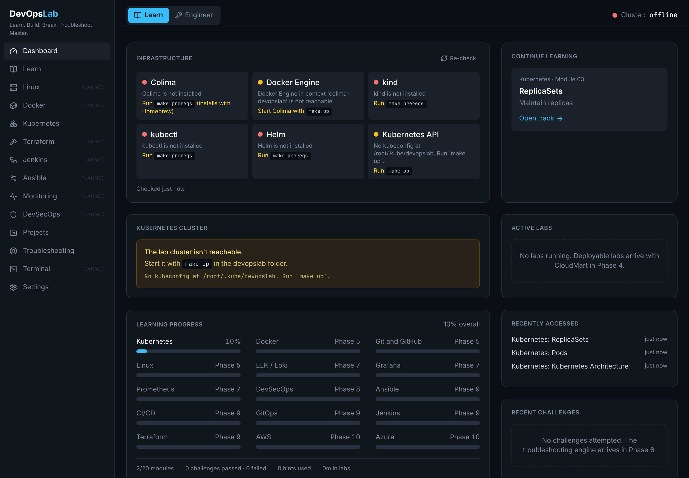
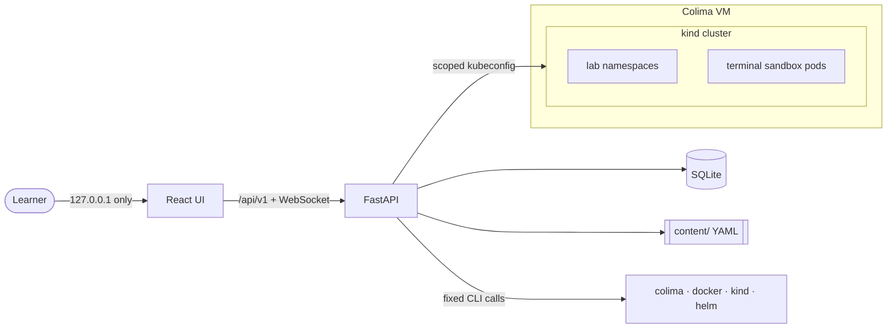
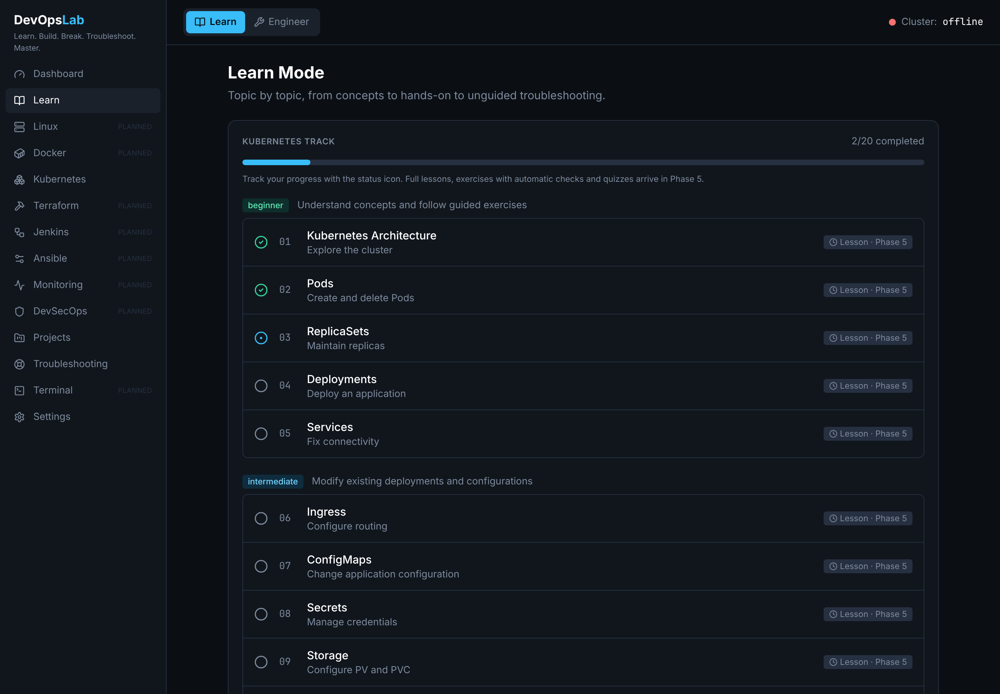
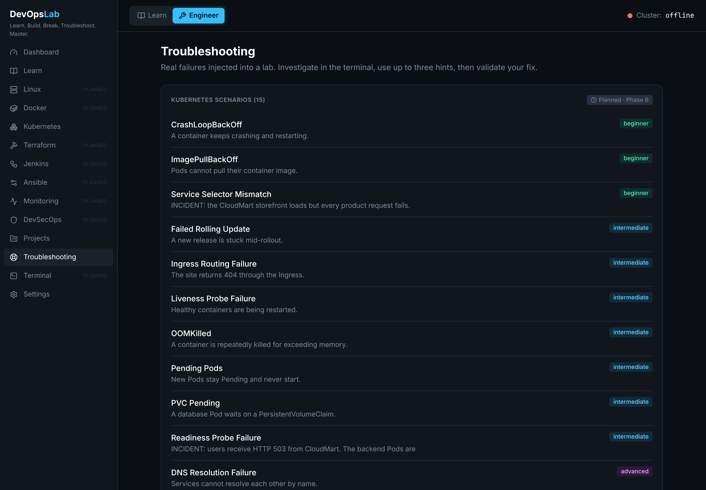

# DevOpsLab

**Learn. Build. Break. Troubleshoot. Master.**

DevOpsLab is an open-source, local-first DevOps engineering playground. It runs a
real Kubernetes cluster on your laptop and gives you two ways to learn:

- **Learn Mode**: structured, topic-by-topic modules from beginner to advanced.
- **Engineer Mode**: production-style projects you deploy, explore, break,
  troubleshoot and reset.
- **AI Teacher** (Phase 9): a personal DevOps instructor running locally on
  [Ollama](https://ollama.com). It explains, demonstrates, quizzes you and helps
  you debug, and never runs a command without your approval.

> **Status: Phase 4 (CloudMart and labs) of 11.** The infrastructure, dashboard, auth,
> health checks, learning catalog, browser terminals (Linux, Kubernetes,
> Docker), the Kubernetes explorer and the CloudMart lab work today. Lessons and the troubleshooting engine are next. Everything not built yet
> is labelled **Planned** in the UI. See the [roadmap](#roadmap).



## Features

| Available now (Phases 1–4) | Planned |
|---|---|
| One-command local cluster: Colima + 3-node kind, ingress, metrics-server; start/stop from the UI | |
| Browser terminals in hardened sandboxes, with tabs: Linux, Kubernetes, and Docker (own engine in a separate on-demand VM) | |
| Live infrastructure health: Colima, Docker Engine, kind, kubectl, Helm, Kubernetes API | |
| Kubernetes explorer: pods, deployments, services, events, namespaces, pod details, live logs, YAML | |
| CloudMart shop (React, FastAPI, PostgreSQL, Redis, Ingress) at http://localhost:8080: deploy, stop, start, reset, delete from the UI, with step-by-step errors, quotas, usage and a 4 h auto-stop | CloudMart Helm chart |
| Learn Mode catalog (15 tracks, 20 Kubernetes modules) with progress tracking | Lessons, exercises with automatic checks, quizzes · Phase 5 |
| Projects and troubleshooting catalogs | 15 Kubernetes troubleshooting scenarios with 3 progressive hints · Phase 6 |
| Local login, session cookies, Origin checks | Prometheus, Grafana, Loki · Phase 7 |
| Content as YAML with JSON Schemas | Trivy, Kyverno, RBAC, NetworkPolicies · Phase 8 |
| SQLite with migrations (PostgreSQL-ready) | **Local AI Teacher** on Ollama: lessons, debugging help, quizzes, mock interviews · Phase 9 |
| Ollama connection check | Jenkins, Argo CD, Terraform, Ansible · Phase 10 |

DevOpsLab never shows sample data: if Colima or the cluster is down, the
dashboard says so and tells you the command that fixes it.

## Supported platforms

| Platform | Status |
|---|---|
| macOS on Apple Silicon (M1–M4), 16 GB RAM | Primary target |
| macOS on Intel | Should work, untested |
| Linux | Planned (provider interface ready) |
| Windows (WSL2) | Planned |

Docker Desktop is **not** required.

## Install (macOS, Apple Silicon)

Prerequisites: [Homebrew](https://brew.sh), about 15 GB free disk.

```bash
git clone <your fork or this repo> devopslab && cd devopslab
make prereqs   # colima, docker CLI, kind, kubectl, helm, node, python
make up        # Colima VM + kind cluster + add-ons + terminal image (first run ~8 min)
make install   # backend venv + frontend packages
make dev       # API on 127.0.0.1:8000, UI on 127.0.0.1:5173
```

`make dev` prints a login link. Open it, or run `make token` in another
terminal to print it again. The token is stored in `~/.devopslab/login-token`
(readable only by you).

Other commands: `make status`, `make down` (stop the VMs, keep the cluster),
`make destroy` (remove everything), `make help`.

The cluster uses its own kubeconfig at `~/.kube/devopslab`, so your default
`kubectl` context is untouched:

```bash
export KUBECONFIG=~/.kube/devopslab
kubectl get nodes
```

### Resource budget (16 GB Mac)

| Component | Budget |
|---|---|
| macOS | 4 GB |
| Colima VM (`COLIMA_MEMORY=6` in `infra/config.env`) | 6 GB |
| Docker terminal VM, only while a Docker terminal is open (`DOCKER_VM_MEMORY=2`) | 2 GB from headroom |
| DevOpsLab UI + API | 0.5 GB |
| Browser + editor | 2 GB |
| Headroom | 3.5 GB |

Heavy components (monitoring, Jenkins, Argo CD) are deployed on demand only.

## Architecture



More: [architecture](docs/architecture.md) · [implementation plan](docs/implementation-plan.md) ·
[API](docs/api.md) · [database](docs/database-schema.md) ·
[AI Teacher](docs/ai-teacher.md) · [terminal security](docs/security/terminal.md) · [lab isolation](docs/security/lab-isolation.md)

## Repository layout

```
backend/   FastAPI app, SQLAlchemy models, Alembic migrations, providers, tests
frontend/  React + TypeScript + Vite + Tailwind UI and tests
content/   tracks, projects, challenges (YAML) + JSON Schemas
infra/     Colima/kind config and setup scripts
docs/      architecture, API, security, screenshots
```

## Screenshots

| Learn Mode | Troubleshooting catalog |
|---|---|
|  |  |

## Development

```bash
make install
make dev            # hot reload for both
make test           # backend lint + tests, frontend type check + lint + tests + build, ShellCheck
make schemas        # regenerate content JSON Schemas
make secrets-scan   # gitleaks (brew install gitleaks)
```

Configuration: copy `.env.example` to `backend/.env`.

## Troubleshooting

| Symptom | Fix |
|---|---|
| Dashboard shows tools as **missing** | `make prereqs`, then restart `make dev` so PATH is picked up |
| Colima **not running** / Docker Engine unreachable | `make up` |
| `colima start` fails on first run | `colima delete -p devopslab` then `make up`; check free disk |
| Cluster unreachable after reboot | `make up` (resumes the VM; the cluster is kept) |
| `make install` fails building pydantic-core | Your default Python is 3.14. `brew install python@3.12`; `make install` picks `python3.12` automatically |
| You also use Docker Desktop | Fine. DevOpsLab uses its own Docker context (`colima-devopslab`) and puts your current context back after `make up` |
| Login says the token is invalid | `make token` and use the new link; tokens rotate if the file was deleted |
| Port 5173 or 8000 already in use | Stop the other process or set `DEVOPSLAB_PORT` / Vite `--port` |
| Mac feels slow | `make down` when you're not using the lab; lower `COLIMA_MEMORY`; use a smaller Ollama model |
| Terminal says `ErrImageNeverPull` or `ImagePullBackOff` | `make images` (builds the terminal image and loads it into the cluster) |
| Terminal says the cluster isn't reachable | `make up` |
| Docker terminal says it couldn't start the Docker VM | Run `make docker-vm-up` to see the full output; `make docker-vm-down` frees its 2 GB |
| Dashboard shows Ollama not reachable | Optional until Phase 9. Install with `brew install ollama`, then `ollama serve` |

## Roadmap

| Phase | Deliverable | Status |
|---|---|---|
| 1 | Foundation: repo, backend, frontend, DB, auth, dashboard, health checks | ✅ |
| 2 | Terminal (xterm.js, isolated sandboxes): Linux, Kubernetes, Docker | ✅ |
| 3 | Kubernetes explorer | ✅ |
| 4 | CloudMart + lab management | ✅ |
| 5 | Learning engine | |
| 6 | Troubleshooting engine | |
| 7 | Observability | |
| 8 | DevSecOps | |
| 9 | Local AI Teacher (Ollama) | |
| 10 | CI/CD and GitOps | |
| 11 | Public release | |

## Contributing and security

See [CONTRIBUTING.md](CONTRIBUTING.md) (content can be added with YAML only),
[SECURITY.md](SECURITY.md) and [CODE_OF_CONDUCT.md](CODE_OF_CONDUCT.md).

## License

[Apache License 2.0](LICENSE).
