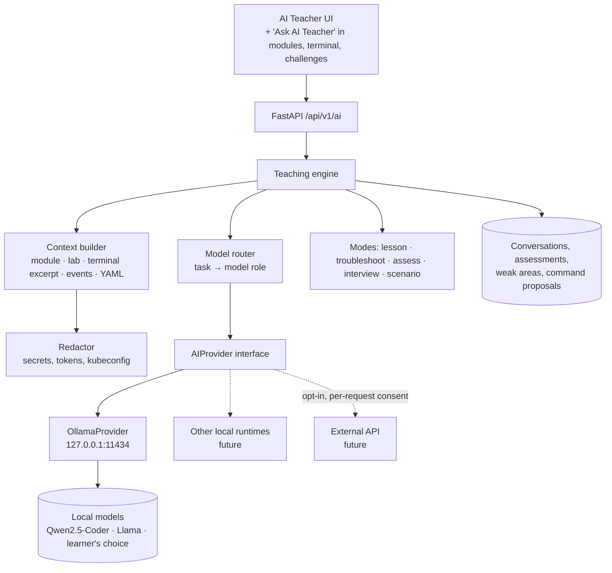

# AI Teacher (Phase 9)

Every learner gets a personal DevOps instructor that runs **on their own
machine**. It teaches one concept at a time, checks understanding, helps
investigate errors without handing over the answer, and never runs anything
without the learner's approval.

Ollama is the default runtime. The design is model- and runtime-independent so
other local runtimes (llama.cpp server, LM Studio, vLLM) or, if the learner
opts in, an external API can be added without changing the rest of the app.

## Architecture

### Provider interface (`backend/app/providers/ai.py`)

| Method | Purpose |
|---|---|
| `health()` | Is the runtime reachable? Version. Used by the dashboard today. |
| `list_models()` | Installed models with size, family, quantisation |
| `chat(messages, model, options)` | Streaming completion (async iterator of tokens) |
| `pull_model(name)` | Download a model the learner chose, with progress (Ollama only) |

Provider metadata says whether it is **local** or **external**. External
providers are disabled until the learner enables them in Settings, and then
each request that would send terminal output, files or cluster data asks for
consent.

### Model roles

The learner maps roles to installed models in Settings; nothing is downloaded
automatically.

| Role | Used for | Suggested default |
|---|---|---|
| `coder` | Commands, scripts, YAML, debugging | `qwen2.5-coder:7b` (≈5 GB RAM) |
| `teacher` | Concept explanations, conversation, assessment | `llama3.2:3b` (≈3 GB RAM) |
| `fallback` | Low-memory machines | `qwen2.5-coder:1.5b` |

On a 16 GB Mac with the lab cluster running (6 GB VM), one 7B model at
Q4 quantisation fits; the UI shows the model's size next to free memory before
loading and warns when it won't fit. Only one model is loaded at a time by
default (`OLLAMA_MAX_LOADED_MODELS=1`, `keep_alive` 5 min).

## Teaching engine

Prompts are assembled from versioned templates in
`content/ai/prompts/*.yaml` (contributors can improve them without code).
Each mode has a structure the model is asked to follow and that the UI renders
as steps.

| Feature | Mode | Output structure |
|---|---|---|
| Ask Anything | `ask` | Answer at the learner's level, one follow-up question |
| Teach Me Step by Step | `lesson` | Concept → real-world analogy → YAML/command with line-by-line explanation → hands-on step → check → follow-up question |
| Explain This Command | `explain_command` | What, why, each flag, expected output, risks |
| Explain This YAML | `explain_yaml` | Line-by-line, what's missing, production notes |
| Debug My Error | `troubleshoot` | What happened → likely causes → how to investigate → commands → expected output → fix → prevention |
| Review My Configuration | `review` | Issues by severity, why, suggested change |
| Generate Practice Exercises | `exercises` | Exercises validated against the content schema before showing |
| Conduct Mock Interviews | `interview` | One question at a time, scored with feedback |
| Test My Knowledge | `assess` | Quiz, graded, mistakes explained, weak areas recorded |
| Give Me a Real-World Scenario | `scenario` | Incident brief; can launch a matching troubleshooting challenge |

### Guide, don't solve

- In a troubleshooting challenge the teacher follows the challenge's hint
  ladder: it may not reveal more than the next unused hint until the learner
  asks for the solution (which is recorded, as in Phase 6).
- Answers in `troubleshoot` mode lead with investigation steps, not the fix,
  unless the learner asks "just tell me".
- When the learner doesn't understand, the engine re-explains with a different
  analogy and a simpler level.

### Adapting to the learner

The engine passes a short learner profile: level per track, completed modules,
recent mistakes and weak areas (from assessments and challenge attempts).
Assessments update weak areas; the dashboard surfaces them and the teacher
revisits them.

### Learner profile and teacher memory

The teacher remembers the learner across conversations through a learning
profile assembled from the database (never from raw chat logs):

| Remembered | Source |
|---|---|
| Topics completed | `module_progress`, passed `challenge_attempts` |
| Concepts the learner struggles with | `weak_areas` (from quizzes, failed exercises, hints used) |
| Previous mistakes | `assessments.feedback`, failed `exercise_attempts` (summaries) |
| Exercise performance | `exercise_attempts`, `assessments` scores |
| Current skill level | per-track level computed from the above |
| Recommended next lesson | next unfinished module, weighted towards weak areas |

A short profile summary is added to every conversation, and the dashboard's
"Continue learning" uses the same recommendation. The learner can view and
reset their profile in Settings.

### Context awareness

Only **approved** context is ever sent. Available sources: current learning
module, Kubernetes cluster status (summary, not credentials), the selected
project's configuration (redacted), terminal output the learner shares,
previous exercise results and learning progress.

The "Ask AI Teacher" button sends the current context, built server-side:

| Where | Context included |
|---|---|
| Learning module | Module, level, lesson section, learner's last answer |
| Terminal | Last N lines the learner selects (never sent automatically) |
| Challenge | Challenge description, symptoms, hints used so far (not the solution) |
| Kubernetes view | Selected resource YAML, recent events, log excerpt |

The learner sees exactly what will be sent before sending.

## Safety and privacy

1. **Local by default.** Ollama on 127.0.0.1. No external API is required or
   contacted in local mode.
2. **Redaction.** Before anything reaches a model, the redactor strips
   kubeconfig contents, bearer tokens, Secret `data`/`stringData` values,
   private keys, passwords in connection strings, and AWS/GCP/Azure key
   patterns. Tests cover each pattern.
3. **Commands need approval.** The model can only *propose* commands, returned
   as structured `command_proposal` objects. The UI shows them with a
   **Run in terminal** button that pastes into the learner's lab terminal
   (Phase 2 sandbox), never the host. Nothing executes without a click, and
   destructive commands (`delete`, `rm -rf`, `drain`, …) get a second
   confirmation. Proposals and decisions are logged.
4. **Learner control.** AI can be turned off entirely in Settings; models can
   be switched or removed at any time. Conversations can be deleted.
5. **External providers** (future) are off by default, labelled clearly, and
   require consent per request when context is attached.

## Data model additions (Phase 9 migration)

| Table | Columns |
|---|---|
| `ai_conversations` | `id`, `user_id`, `mode`, `context_kind`, `context_ref`, `model`, `created_at`, `updated_at` |
| `ai_messages` | `id`, `conversation_id`, `role`, `content`, `redactions` (count), `created_at` |
| `ai_command_proposals` | `id`, `message_id`, `command`, `risk` (`read`/`write`/`destructive`), `decision` (`pending`/`approved`/`rejected`), `decided_at` |
| `assessments` | `id`, `user_id`, `kind` (`quiz`/`interview`/`assignment`), `topic`, `score`, `max_score`, `feedback`, `created_at` |
| `weak_areas` | `user_id`, `topic`, `skill`, `evidence_count`, `last_seen_at` |
| `learner_profiles` | `user_id`, `track_id`, `level`, `recommended_module_id`, `summary`, `updated_at` |

AI settings (enabled, provider, base URL, role → model map) live in the
existing `settings` table.

## API (Phase 9)

| Method | Path | Notes |
|---|---|---|
| GET | `/ai/status` | Provider, reachable, version, enabled |
| GET | `/ai/models` | Installed models + role mapping |
| PUT | `/ai/settings` | Enable/disable, base URL, role → model |
| POST | `/ai/models/pull` | `{name}`; streams progress (SSE) |
| POST | `/ai/conversations` | `{mode, context?}` → conversation |
| POST | `/ai/conversations/{id}/messages` | `{content, attach_context}`; streams reply (SSE) with `command_proposal` events |
| POST | `/ai/proposals/{id}/decision` | `{decision: approved\|rejected}`; approved → sent to the lab terminal |
| POST | `/ai/assessments` | `{topic, kind}` → generated quiz; answers graded via messages |
| GET | `/ai/weak-areas` | For dashboard and adaptive teaching |
| DELETE | `/ai/conversations/{id}` | |

## Phase 9 acceptance criteria

1. With Ollama running and a model installed, the AI Teacher answers
   with streaming output; with Ollama stopped, the UI says so and how to fix it.
2. The learner can pick models per role; nothing downloads without consent.
3. All 10 features above work for the Kubernetes track.
4. "Ask AI Teacher" works from a module, the terminal (selected lines) and a
   challenge, and shows the context before sending.
5. A command proposal never runs without approval; destructive commands need
   a second confirmation; tests prove the backend rejects execution without an
   approved proposal.
6. Redaction tests pass for every listed secret pattern; a test proves no
   request leaves 127.0.0.1 in local mode.
7. Quizzes are graded, mistakes explained, and weak areas appear on the
   dashboard.
9. A new conversation knows completed topics, weak areas and the recommended
   next lesson without the learner repeating them; the learner can reset it.
8. Turning AI off hides every AI entry point and stops all calls.

## In Phase 1 already

- `AIProvider` interface and `OllamaProvider.health()`; the dashboard shows
  whether Ollama is reachable (optional component, never an error).
- AI Teacher section in the sidebar, marked Planned · Phase 9.
