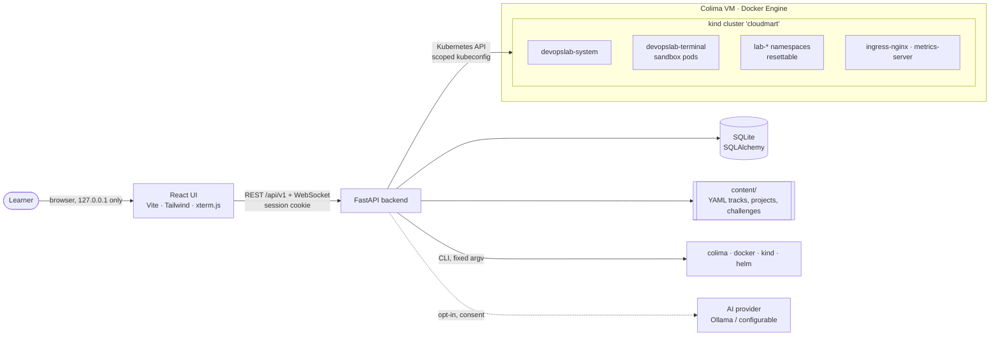

# DevOpsLab architecture

DevOpsLab is a local-first engineering playground. A FastAPI backend on the
host talks to real infrastructure (Colima, Docker Engine, kind, Kubernetes) and
serves a React UI. Learners work inside isolated lab environments: sandbox
pods and namespaces in the lab cluster, never the host.

## System context



## Backend modules

```
backend/app/
  core/        config, errors (one JSON error shape), security helpers
  db/          SQLAlchemy models, engine/session, Alembic migrations
  auth/        AuthProvider interface, LocalTokenAuth, session dependency
  providers/   pluggable interfaces with one implementation each:
    runtime.py    ContainerRuntime    -> ColimaRuntime
    cluster.py    ClusterProvider     -> KindCluster
    terminal.py   TerminalProvider    -> (Phase 2) KubeExecTerminal
    labs.py       LabProvisioner      -> NamespaceLabProvisioner
    ai.py         AIProvider          -> (planned) Ollama, OpenAI-compatible
  content/     Pydantic models for content + loader (validates on startup)
  api/v1/      HTTP routers; thin, call providers and db
```

Providers are selected in `core/config.py` so a Linux or Windows runtime,
a k3d/minikube cluster, or a hosted multi-user lab provisioner can be added
without touching routers.

## Content is data

Educational content lives in `content/` at the repo root, not in the backend:

```
content/
  schemas/      JSON Schemas generated from the Pydantic models (make schemas)
  tracks/       one YAML per technology: modules, levels, lessons, exercises
  projects/     Engineer Mode project catalog
  challenges/   troubleshooting scenarios, one YAML each
```

The backend validates everything at startup and refuses to start on invalid
content, printing the file and field at fault. Contributors add modules or
challenges with YAML only. See `CONTRIBUTING.md`.

## Runtime topology on a 16 GB Mac

| Component                       | Budget  | Notes                                  |
|---------------------------------|---------|----------------------------------------|
| macOS                           | 4 GB    |                                        |
| Colima VM (`COLIMA_MEMORY=6`)   | 6 GB    | kind nodes, add-ons, labs              |
| DevOpsLab UI + API              | 0.5 GB  | host processes                         |
| Browser + editor                | 2 GB    |                                        |
| Headroom                        | 3.5 GB  |                                        |

Heavy projects (monitoring, Jenkins, Argo CD) deploy on demand only. The
backend checks free VM memory before deploying and refuses with a clear message
when the budget would be exceeded.

## Security boundaries

- [Terminal security boundaries](security/terminal.md)
- [Lab isolation](security/lab-isolation.md)
- Network: backend, Vite and ingress host ports bind to 127.0.0.1 only.
- Auth: every API and WebSocket requires a session (see `docs/api.md`).
- AI: off by default; nothing leaves the machine without explicit consent per
  request.
