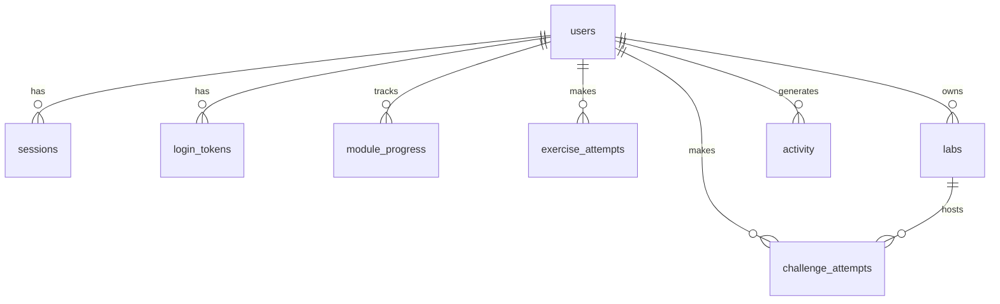

# Database schema

SQLAlchemy 2.0 models in `backend/app/db/models.py`, migrated with Alembic.
SQLite by default (`~/.devopslab/devopslab.db`); every type used is portable to
PostgreSQL (no SQLite-only features, timezone-aware timestamps stored as UTC,
string ids where a natural key exists). Switch with `DEVOPSLAB_DATABASE_URL`.

| Table | Purpose | Key columns | Phase |
|---|---|---|---|
| `users` | Accounts. One `admin` created on first run | `id`, `username` (unique), `role` (`admin`/`learner`), `created_at` | 1 |
| `login_tokens` | Hashed login tokens (SHA-256) | `id`, `user_id`, `token_hash` (unique), `created_at`, `revoked_at` | 1 |
| `sessions` | Browser sessions; id stored hashed | `id_hash` (PK), `user_id`, `created_at`, `last_seen_at`, `expires_at`, `user_agent` | 1 |
| `module_progress` | Learn Mode module state | `user_id`+`module_id` (unique), `track_id`, `status` (`started`/`completed`), `started_at`, `completed_at`, `time_spent_seconds` | 1 |
| `exercise_attempts` | Each validated exercise run | `id`, `user_id`, `module_id`, `exercise_id`, `passed`, `output_summary`, `attempted_at` | 5 |
| `labs` | Lab lifecycle | `id`, `user_id`, `kind` (`module`/`challenge`/`project`), `ref_id`, `status` (`creating`/`running`/`stopped`/`resetting`/`failed`/`deleting`), `namespaces` (JSON), `last_error`, `created_at`, `updated_at`, `expires_at` | 1 (table), 4 (engine) |
| `challenge_attempts` | Troubleshooting runs | `id`, `user_id`, `challenge_id`, `lab_id`, `status` (`in_progress`/`passed`/`failed`/`abandoned`), `hints_used`, `solution_viewed`, `validation_runs`, `started_at`, `finished_at` | 1 (table), 6 (engine) |
| `activity` | Recent items for the dashboard | `id`, `user_id`, `kind` (`module`/`project`/`challenge`), `ref_id`, `title`, `at` | 1 |
| `settings` | Key/value app settings (AI provider etc.) | `key` (PK), `value` (JSON), `updated_at` | 1 |

Derived metrics (no extra tables): overall progress, skills practised (union of
`skills` from completed modules and passed challenges), learning time (sum of
`time_spent_seconds` + challenge durations), failed attempts (count of
`challenge_attempts.status='failed'` + failed `exercise_attempts`).
